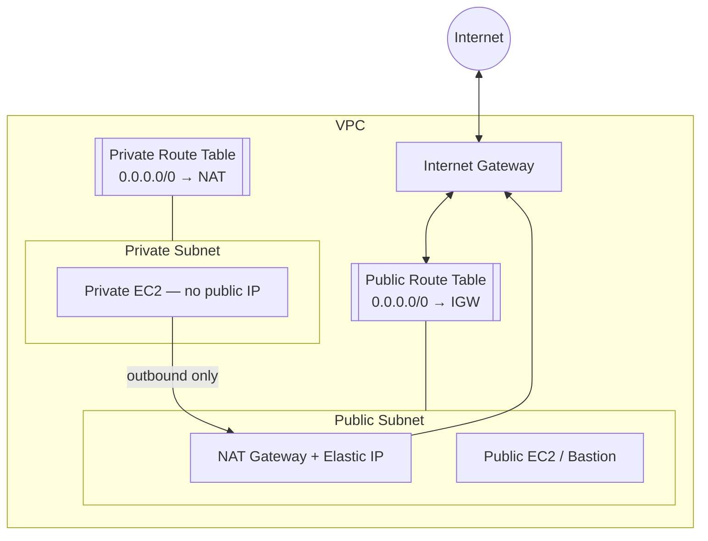
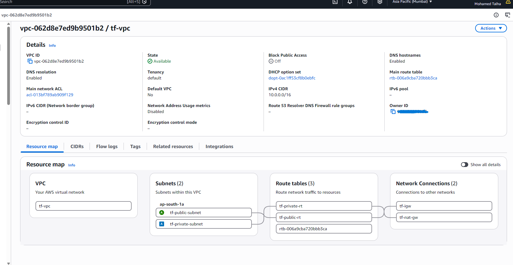
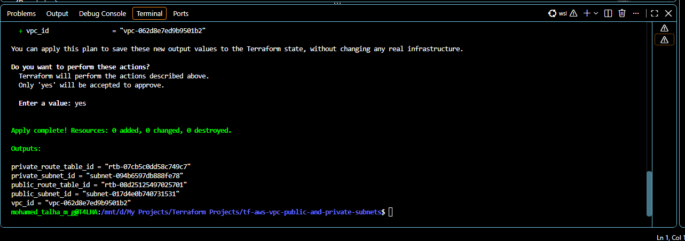

<div align="center">

# AWS VPC with Public & Private Subnets — Terraform

**Infrastructure as Code that provisions a secure, production-style AWS network: a custom VPC, public and private subnets, an Internet Gateway, a NAT Gateway and isolated route tables.**


</div>

---

## Table of Contents

- [Overview](#overview)
- [Architecture](#architecture)
- [Resources Provisioned](#resources-provisioned)
- [Project Structure](#project-structure)
- [Prerequisites](#prerequisites)
- [Deployment](#deployment)
- [Inputs](#inputs)
- [Outputs](#outputs)
- [Screenshots](#screenshots)
- [Cost & Cleanup](#cost--cleanup)
- [Security](#security)
- [Roadmap](#roadmap)
- [Author](#author)

---

## Overview

This project automates the creation of a two-tier AWS network with Terraform. The design follows the standard pattern used to host internet-facing and internal workloads separately:

- **Public subnet:** hosts internet-facing resources such as bastion hosts, load balancers and the NAT Gateway. Traffic routes directly through an **Internet Gateway**.
- **Private subnet:** hosts internal resources such as application servers and databases. Instances have **no public IP** and are unreachable from the internet, but can still make outbound connections (OS updates, package installs) through a **NAT Gateway**.

The configuration is fully parameterised, so the same code can be deployed to any region or CIDR range without modification.

---

## Architecture



### Traffic Flow

| Source | Path | Result |
|--------|------|--------|
| Public subnet → Internet | Public route table → IGW | Inbound and outbound access |
| Private subnet → Internet | Private route table → NAT Gateway → IGW | Outbound only |
| Internet → Private subnet | — | Blocked, no inbound route |

---

## Resources Provisioned

| Resource | Terraform Type | Purpose |
|----------|----------------|---------|
| VPC | `aws_vpc` | Isolated network with DNS support and hostnames enabled |
| Public Subnet | `aws_subnet` | Auto-assigns public IPv4 addresses on launch |
| Private Subnet | `aws_subnet` | No public IP assignment |
| Internet Gateway | `aws_internet_gateway` | Provides internet connectivity to the VPC |
| Public Route Table | `aws_route_table` | Default route `0.0.0.0/0` → Internet Gateway |
| Public RT Association | `aws_route_table_association` | Binds the public subnet to the public route table |
| Elastic IP | `aws_eip` | Static public IP for the NAT Gateway |
| NAT Gateway | `aws_nat_gateway` | Outbound internet access for the private subnet |
| Private Route Table | `aws_route_table` | Default route `0.0.0.0/0` → NAT Gateway |
| Private RT Association | `aws_route_table_association` | Binds the private subnet to the private route table |

**Total: 10 resources.** Every resource is tagged with `Project` and `ManagedBy = Terraform` through provider default tags.

---

## Project Structure

```
.
├── provider.tf       # Terraform & AWS provider configuration, default tags
├── variables.tf      # Input variable definitions with validation
├── main.tf           # VPC, subnets, IGW, NAT Gateway, route tables
├── output.tf         # Exported resource IDs
├── .gitignore        # Excludes state, secrets and provider cache
├── screenshots/      # Deployment evidence (VPC resource map, Terraform output)
└── README.md
```

---

## Prerequisites

| Requirement | Version |
|-------------|---------|
| [Terraform](https://developer.hashicorp.com/terraform/install) | >= 1.5 |
| [AWS CLI](https://docs.aws.amazon.com/cli/latest/userguide/getting-started-install.html) | v2, configured with `aws configure` |
| IAM permissions | `AmazonVPCFullAccess` or equivalent EC2/VPC permissions |

---

## Deployment

```bash
# Clone the repository
git clone https://github.com/<your-github-username>/terraform-aws-vpc-public-private-subnets.git
cd terraform-aws-vpc-public-private-subnets

# Configure input values
# edit values as required
source .env

# Deploy
terraform init
terraform validate
terraform plan -out=tfplan
terraform apply tfplan
```

---

## Inputs

| Name | Description | Type | Example |
|------|-------------|------|---------|
| `aws_region` | AWS region to deploy into | `string` | `ap-south-1` |
| `availability_zone` | Availability Zone for both subnets | `string` | `ap-south-1a` |
| `project_name` | Prefix applied to all resource names | `string` | `tf-vpc-project` |
| `vpc_cidr` | CIDR block for the VPC | `string` | `10.0.0.0/16` |
| `public_subnet_cidr` | CIDR block for the public subnet | `string` | `10.0.1.0/24` |
| `private_subnet_cidr` | CIDR block for the private subnet | `string` | `10.0.2.0/24` |

All CIDR inputs are validated before any resources are created.

---

## Outputs

| Name | Description |
|------|-------------|
| `vpc_id` | ID of the VPC |
| `public_subnet_id` | ID of the public subnet |
| `private_subnet_id` | ID of the private subnet |
| `public_route_table_id` | ID of the public route table |
| `private_route_table_id` | ID of the private route table |

---

## Screenshots

### VPC Resource Map — AWS Console
The VPC resource map confirms both subnets, the public and private route tables, the Internet Gateway and the NAT Gateway, all provisioned by Terraform.



### Terraform Apply Output
Resource IDs exported by Terraform after a successful `terraform apply`.



---

## Cost & Cleanup

| Resource | Cost |
|----------|------|
| VPC, subnets, route tables, Internet Gateway | No charge |
| NAT Gateway | Hourly charge + per-GB data processing |
| Elastic IP | Hourly charge for public IPv4 addresses |

To avoid ongoing charges, destroy the infrastructure when it is no longer needed:

```bash
terraform destroy
```

---

## Security

- No credentials are stored in code. Authentication uses the AWS CLI profile.
- No environment-specific values are hard-coded in the Terraform configuration.
- State files, local configuration and provider caches are excluded from version control.
- The private subnet has no inbound route from the internet.
- Input validation prevents malformed CIDR blocks from being applied.

---

## Roadmap

- [ ] Multi-AZ subnets for high availability
- [ ] Remote state backend on S3 with DynamoDB state locking
- [ ] Refactor into a reusable Terraform module
- [ ] Security groups and a bastion host
- [ ] VPC Flow Logs to CloudWatch
- [ ] GitHub Actions pipeline for `fmt`, `validate` and `plan`

---

## Author

**Mohamed Talha M G**
DevOps Engineer | AWS | Terraform

[](https://www.linkedin.com/in/<your-linkedin-id>)
[](https://github.com/<your-github-username>)

---

<div align="center">

If you found this project useful, consider giving it a ⭐

</div>
